# Gorgée

**Le jeu de soirée qui fait boire tout le monde.** Gorgée est une petite plateforme de jeux de soirée en temps réel, façon Kahoot : la TV (ou le PC) affiche le jeu, chacun joue en secret depuis son téléphone… et les perdants boivent.

| Accueil | Choix du jeu |
|---|---|
| 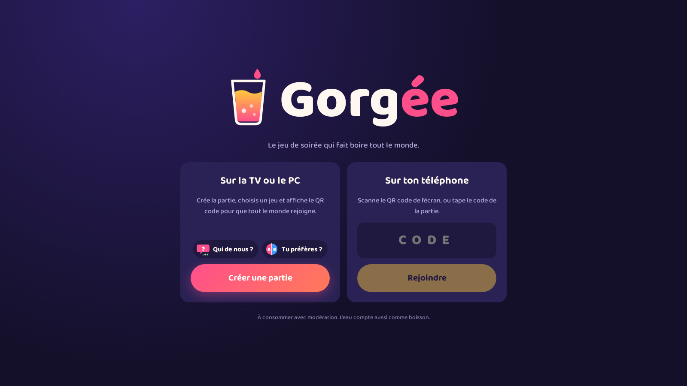 | 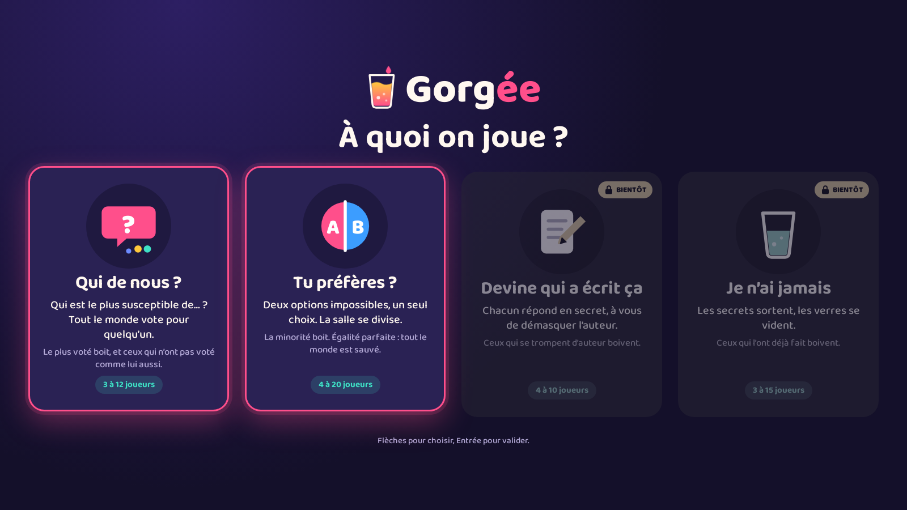 |

## Les jeux

Après **Créer une partie**, l'hôte choisit le jeu dans une grille de cartes. On peut changer de jeu entre deux parties sans que personne n'ait à rescanner le QR code.

| Jeu | Le principe | Qui boit | Joueurs |
|---|---|---|---|
| **Qui de nous ?** | « Qui est le plus susceptible de… ? » Tout le monde vote pour un joueur. | Le plus voté, et ceux qui n'ont pas voté pour lui | 3 à 12 |
| **Tu préfères ?** | Deux options impossibles, chacun choisit A ou B. | La minorité | 4 à 20 |
| **Estimation** | Une question, un nombre : qui tape le plus près ? | Le plus éloigné (+ quelqu'un désigné par le plus proche) | 2 à 20 |
| **Qui me connaît le mieux ?** | Un joueur répond en secret sur lui-même, les autres devinent. | Ceux qui se trompent | 3 à 20 |
| **L'Imposteur** | Tout le monde a le même mot sauf un. Un indice chacun, puis on vote. | L'imposteur s'il est démasqué, sinon tout le groupe | 4 à 20 |
| **Patate chaude** | Une bombe passe de téléphone en téléphone, mèche cachée. | Celui qui l'a quand elle explose | 3 à 20 |
| **La Roue** | Une roue choisit un joueur, une deuxième son défi. | Selon le défi : gorgées, duo, vote, gage… | 2 à 20 |
| **Réflexes** | La TV dit des mots qui ressemblent à « feu ». On tape seulement sur « FEU ». | Le plus lent, les faux départs, ceux qui ne tapent pas | 2 à 20 |

Tous les jeux partagent le même lobby, le mode auto, les minuteurs, le compteur de gorgées et le podium de fin.

### Qui de nous ?

| Écran (TV / PC) | | |
|---|---|---|
| 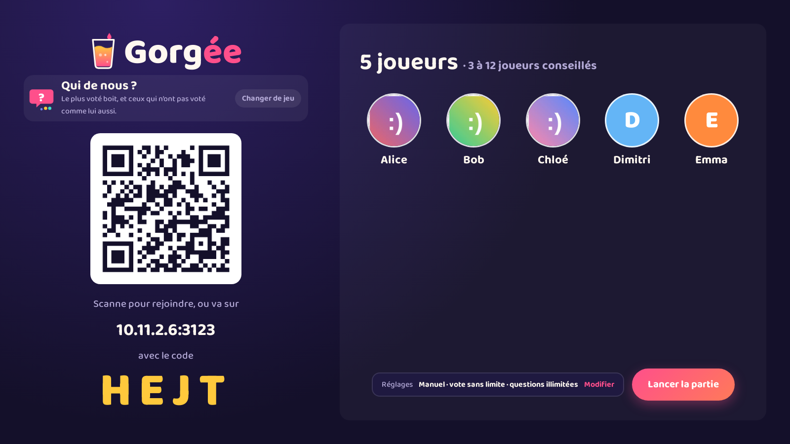 | 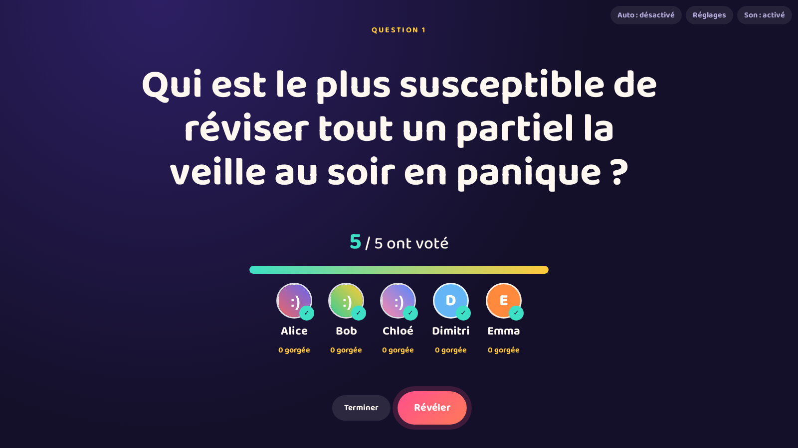 | 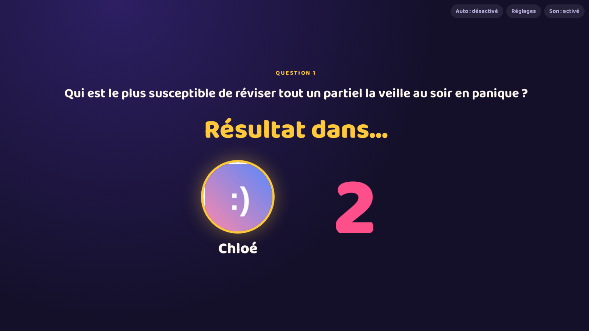 |
| 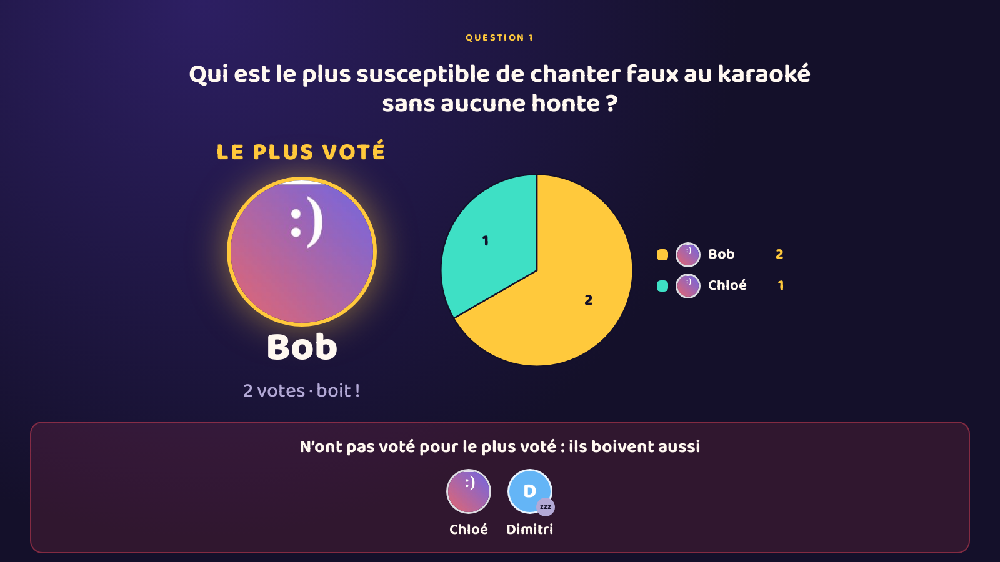 | | |

| Téléphone | | |
|---|---|---|
| 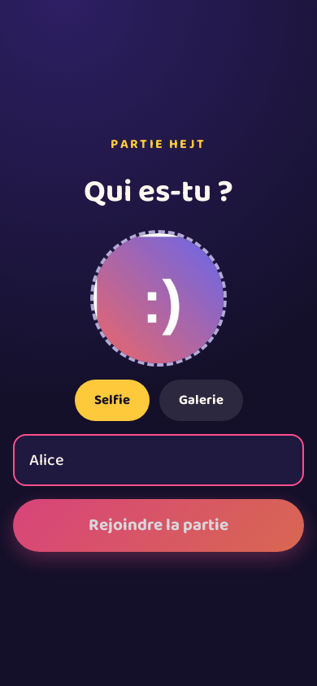 | 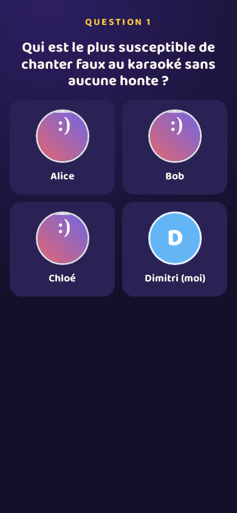 | 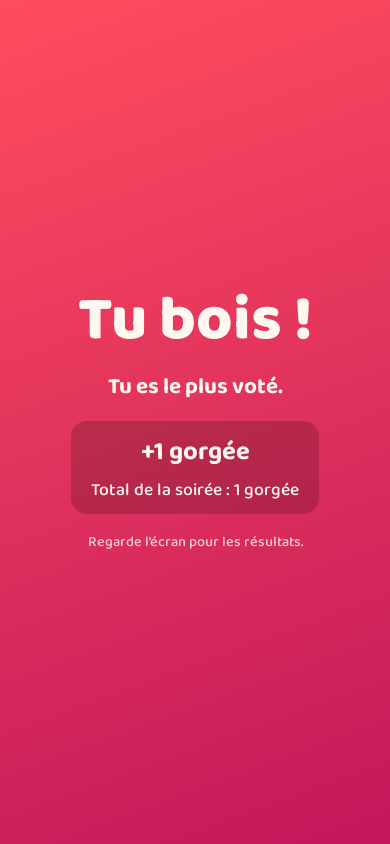 |

### Tu préfères ?

| Écran (TV / PC) | | |
|---|---|---|
| 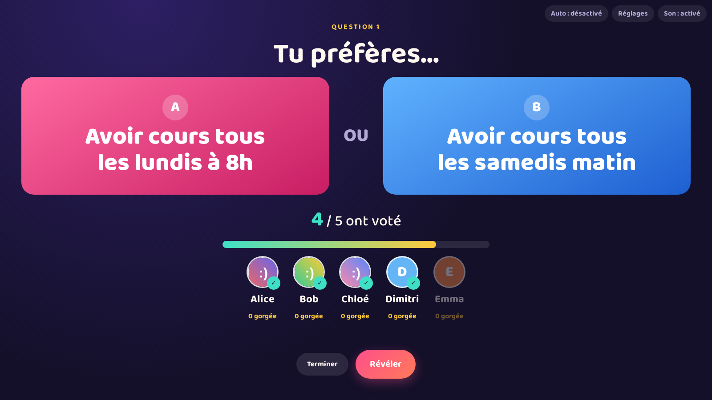 | 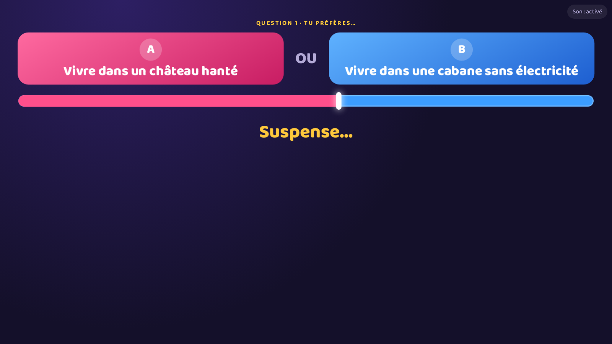 | 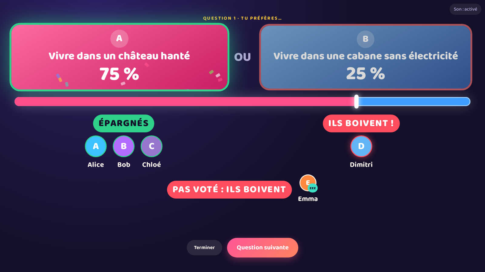 |

| Téléphone | | |
|---|---|---|
| 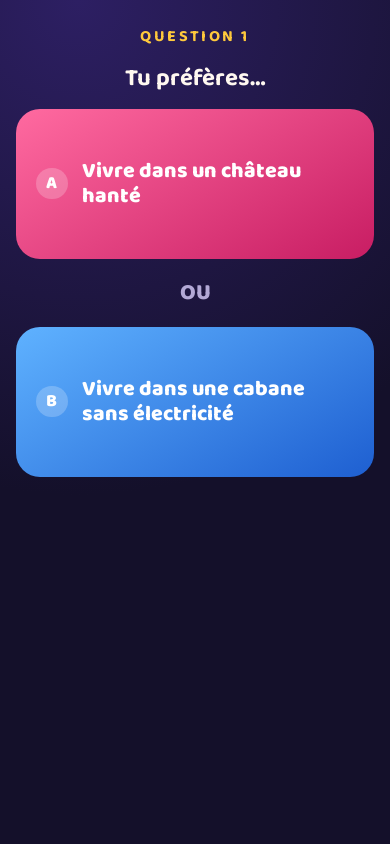 |  | 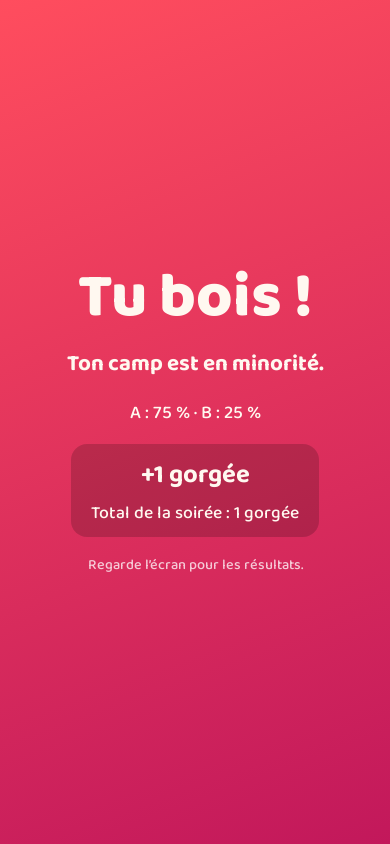 |

### Fin de partie

| Podium (TV) | Classement (téléphone) |
|---|---|
| 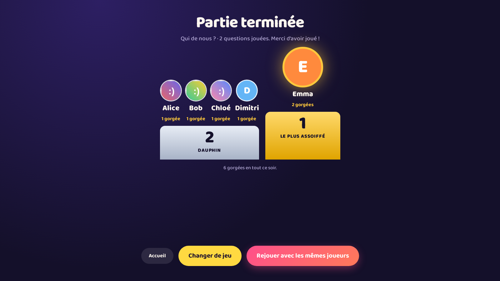 | 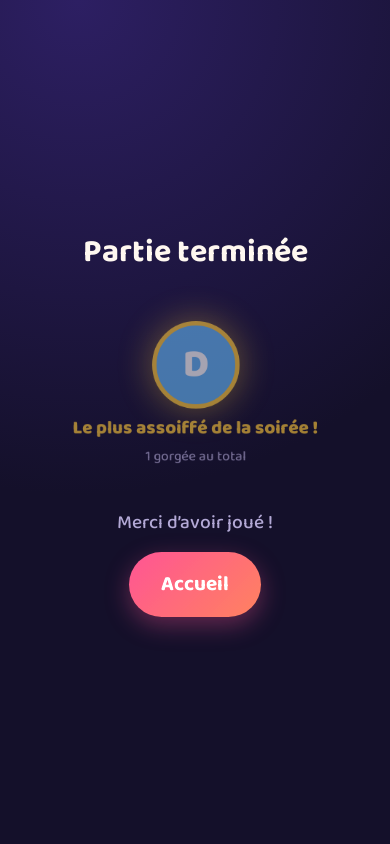 |

## Sommaire

- [Les jeux](#les-jeux)
- [Fonctionnalités](#fonctionnalités)
- [Démarrage rapide](#démarrage-rapide)
- [Tutoriel pas à pas](#tutoriel-pas-à-pas)
  - [1. Installer Node.js](#1-installer-nodejs)
  - [2. Récupérer le projet](#2-récupérer-le-projet)
  - [3. Installer et construire](#3-installer-et-construire)
  - [4. Jouer sur le même Wi-Fi](#4-jouer-sur-le-même-wi-fi)
  - [5. Jouer à distance (sans même Wi-Fi)](#5-jouer-à-distance-sans-même-wi-fi)
  - [6. Déroulement d'une partie](#6-déroulement-dune-partie)
  - [Réglages de la partie (mode auto, minuteurs, pause)](#réglages-de-la-partie)
  - [Mode soirée](#mode-soirée)
  - [Mode 18+](#mode-18)
  - [Récap de fin de soirée](#récap-de-fin-de-soirée)
- [Règles du jeu](#règles-du-jeu)
  - [Qui de nous ?](#qui-de-nous--1)
  - [Tu préfères ?](#tu-préfères--1)
- [Dépannage](#dépannage)
- [Personnaliser les questions](#personnaliser-les-questions)
  - [Ajouter des questions : checklist qualité](#ajouter-des-questions--checklist-qualité)
- [Héberger en ligne (gratuit)](#héberger-en-ligne-gratuit)
- [Développement](#développement)
- [Licence](#licence)

## Fonctionnalités

- **Plusieurs jeux dans une seule plateforme** : on choisit le jeu dans une grille de cartes (au clavier, à la souris ou au tactile), et on peut changer de jeu entre deux parties sans que personne n'ait à rescanner.
- Un seul site : l'écran crée la partie, les téléphones la rejoignent en scannant un **QR code** (ou en tapant un code de 4 lettres).
- Chaque joueur choisit son **prénom** et sa **photo** (selfie ou galerie, compressée automatiquement).
- **Vote secret en temps réel** avec compteur « X / N ont voté » sur l'écran.
- **Suspense avant chaque révélation**, puis résultats animés :
  - *Qui de nous ?* : « Attention… », les photos défilent comme une roulette pendant un compte à rebours 3-2-1 (roulement de tambour, écran qui tremble), puis le plus voté en grand, un camembert de la répartition et la liste de ceux qui boivent en plus.
  - *Tu préfères ?* : « Attention… », puis une jauge oscille entre A et B, ralentit, hésite et se pose sur le vrai résultat (avec tic-tac sonore). Les photos des joueurs atterrissent ensuite dans leur camp, et la majorité a droit à des confettis.
- Chaque téléphone affiche **« Les résultats arrivent… »** pendant le suspense, puis **« Tu bois ! »** ou **« Tu ne bois pas »** au même moment que la TV : personne n'est spoilé.
- **Mode auto** : la révélation se lance dès que tout le monde a voté, puis la question suivante arrive toute seule après un compte à rebours. Il propose aussi une pause, un minuteur de vote et un nombre de questions maximum (voir [Réglages de la partie](#réglages-de-la-partie)).
- **Mode soirée** : un seul bouton, et Gorgée enchaîne les jeux tout seul pendant 30 min, 1 h, 2 h ou sans fin (voir [Mode soirée](#mode-soirée)).
- **Récap de fin de soirée** : trophées révélés un par un sur la TV, et une image au format story à partager (voir [Récap de fin de soirée](#récap-de-fin-de-soirée)).
- **Compteur de gorgées** : chaque joueur voit son total sur la TV et sur son téléphone, et la partie se termine sur un **podium** des plus assoiffés.
- **Reconnexion automatique** : un joueur qui recharge sa page ou perd le réseau retrouve sa place (et son vote).
- 520 questions et 500 dilemmes pensés pour les soirées étudiantes, du plus chill au plus osé, tirés au hasard sans répétition (et des centaines de mots, défis et questions chiffrées pour les autres jeux).
- Aucun compte, aucune base de données : les parties vivent en mémoire et disparaissent toutes seules.

## Démarrage rapide

Si tu as déjà Node.js 18 ou plus :

```bash
git clone https://github.com/Kaloomc/qui-de-nous.git
cd qui-de-nous
npm install
npm run build
npm start
```

Ouvre ensuite **http://localhost:3000** sur le PC branché à la TV, clique sur **Créer une partie**, puis choisis le jeu dans la grille.

> Le dépôt s'appelle encore `qui-de-nous` sur GitHub : l'URL de clone et le nom du dossier changeront quand il sera renommé.

## Tutoriel pas à pas

### 1. Installer Node.js

Il faut **Node.js 18 ou plus récent**. Vérifie ta version :

```bash
node -v
```

Si la commande n'existe pas ou affiche une version inférieure à 18 :

- **Windows / macOS** : télécharge l'installeur « LTS » sur [nodejs.org](https://nodejs.org).
- **Linux (avec droits admin)** : passe par [nvm](https://github.com/nvm-sh/nvm) :
  ```bash
  curl -o- https://raw.githubusercontent.com/nvm-sh/nvm/v0.40.1/install.sh | bash
  # ferme et rouvre le terminal, puis :
  nvm install --lts
  ```
- **Linux sans droits admin** (ex. machine d'école) : installe Node dans ton dossier perso :
  ```bash
  mkdir -p ~/.local/node
  curl -fsSL https://nodejs.org/dist/v22.11.0/node-v22.11.0-linux-x64.tar.xz | tar -xJ --strip-components=1 -C ~/.local/node
  echo 'export PATH="$HOME/.local/node/bin:$PATH"' >> ~/.zshrc   # ou ~/.bashrc
  source ~/.zshrc
  ```

### 2. Récupérer le projet

```bash
git clone https://github.com/Kaloomc/qui-de-nous.git
cd qui-de-nous
```

Pas de git ? Sur la page GitHub du projet, clique sur **Code → Download ZIP** et décompresse l'archive.

### 3. Installer et construire

```bash
npm install      # télécharge les dépendances (une seule fois)
npm run build    # construit le site (à refaire après chaque modification du code)
```

### 4. Jouer sur le même Wi-Fi

C'est le mode le plus simple quand tout le monde est dans la même pièce.

```bash
npm start
```

Le terminal affiche :

```
Gorgée — serveur sur le port 3000
  Local : http://localhost:3000
  Réseau : http://192.168.1.42:3000
```

1. Sur le PC branché à la TV, ouvre **http://localhost:3000**, clique sur **Créer une partie** et choisis un jeu.
2. Les téléphones (connectés au **même Wi-Fi** que le PC) scannent le QR code. Le QR code utilise automatiquement l'adresse « Réseau » du PC.
3. Pour arrêter le jeu : `Ctrl + C` dans le terminal.

### 5. Jouer à distance (sans même Wi-Fi)

Les joueurs sont en 4G, sur un autre réseau, ou le Wi-Fi bloque les connexions entre appareils ? Utilise un **tunnel Cloudflare** : gratuit, sans compte, il donne au jeu une adresse publique en `https://`.

**Installer `cloudflared` (une seule fois)**

- **Linux (sans droits admin)** :
  ```bash
  mkdir -p ~/.local/bin
  curl -fsSL https://github.com/cloudflare/cloudflared/releases/latest/download/cloudflared-linux-amd64 -o ~/.local/bin/cloudflared
  chmod +x ~/.local/bin/cloudflared
  # si ~/.local/bin n'est pas dans ton PATH :
  echo 'export PATH="$HOME/.local/bin:$PATH"' >> ~/.zshrc && source ~/.zshrc
  ```
- **macOS** : `brew install cloudflared`
- **Windows** : `winget install --id Cloudflare.cloudflared`

**Lancer le jeu en mode partagé**

```bash
npm run build   # si ce n'est pas déjà fait
npm run share
```

Après quelques secondes, le terminal affiche :

```
==================================================================
  Gorgée est en ligne ! Ouvre cette adresse sur la TV / le PC :
  https://exemple-de-mots-aleatoires.trycloudflare.com
==================================================================
```

1. Ouvre **cette adresse** (et pas `localhost`) sur la TV / le PC, puis crée la partie.
2. Le QR code pointe vers l'adresse publique : les joueurs peuvent la scanner depuis n'importe où.
3. `Ctrl + C` arrête le serveur et le tunnel.

> L'adresse change à chaque lancement, et le PC doit rester allumé pendant la partie. Pour une adresse fixe, voir [Héberger en ligne](#héberger-en-ligne-gratuit).

### 6. Déroulement d'une partie

**Sur l'écran (hôte)**

1. Sur l'accueil, clique sur **Créer une partie**.
2. **Choisis le jeu** dans la grille : flèches + Entrée au clavier (pratique avec une télécommande ou un clavier sans fil), ou un clic sur la carte. Les cartes « Bientôt » ne sont pas encore jouables. Le dernier jeu choisi est présélectionné la fois suivante.
3. Le lobby affiche le jeu choisi (avec un bouton **Changer de jeu**), un QR code et un code de 4 lettres.
4. Les joueurs apparaissent au fur et à mesure. Survole une photo et clique sur **×** pour retirer quelqu'un.
5. Si tu veux que la partie tourne toute seule, clique sur **Réglages** et active le **mode auto** (voir [Réglages de la partie](#réglages-de-la-partie)).
6. **Lancer la partie** (au moins 2 joueurs).
7. La question s'affiche avec le compteur de votes. Clique sur **Révéler** quand tout le monde a voté (le bouton pulse), ou avant si quelqu'un traîne. En mode auto, la révélation se lance toute seule.
8. Quelques secondes de suspense, puis les résultats. Clique sur **Question suivante**, ou laisse le compte à rebours la lancer en mode auto. **Terminer** arrête la partie quand vous en avez assez.
9. **Terminer** affiche le **podium** : les 3 joueurs qui ont bu le plus de gorgées (ex æquo sur la même marche), le reste du classement et le total de la soirée. Chaque téléphone affiche aussi sa place.
10. Après la fin, **Rejouer avec les mêmes joueurs** relance le même jeu (avec les mêmes réglages), et **Changer de jeu** ramène à la grille des jeux. Les joueurs restent connectés : personne n'a à rescanner.

Active le son de la TV pour le roulement de tambour, le tic-tac de la jauge et le « ding » de la révélation. Le bouton **Son** en haut à droite permet de le couper.

**Sur le téléphone (joueur)**

1. Scanne le QR code (ou va sur le site et tape le code).
2. Entre ton prénom, prends un selfie (ou choisis une photo), puis **Rejoindre la partie**. Le téléphone affiche le jeu choisi, ou « L'hôte choisit le jeu… » tant que la TV est sur la grille.
3. À chaque question, touche la personne de ton choix (*Qui de nous ?*) ou le gros bouton **A** ou **B** (*Tu préfères ?*). Tu peux **changer ton vote** jusqu'à la révélation. Si un minuteur de vote est réglé, il s'affiche en haut de l'écran.
4. Pendant le suspense, le téléphone affiche « Les résultats arrivent… ». Il devient ensuite **rouge (tu bois)** ou **vert (tu es épargné)**, en même temps que la TV, avec les gorgées du tour et ton total de la soirée.

### Réglages de la partie

Le bouton **Réglages** est disponible dans le lobby (sous la liste des joueurs) et pendant la partie (en haut à droite de la TV). Les réglages sont gardés quand on rejoue, et retenus par la TV pour les prochaines parties.

| Réglage | Choix | Effet |
|---|---|---|
| **Mode auto** | Activé / désactivé (par défaut) | Révèle dès que tous les joueurs connectés ont voté, puis lance la question suivante après le temps d'affichage des résultats. |
| **Affichage des résultats** | 5 / 10 / 15 / 20 s | Temps laissé pour lire qui boit avant la question suivante (mode auto). Une barre qui se vide le montre sur la TV. |
| **Minuteur de vote** | Sans limite / 15 / 30 / 45 s | À zéro, on révèle avec les votes reçus : ceux qui n'ont pas voté boivent. Fonctionne aussi en mode manuel. |
| **Nombre de questions** | Illimité / 10 / 20 / 30 | En mode auto, la partie se termine toute seule après la dernière. En manuel, la TV propose « Terminer la partie » ou « Encore une question ». |

**Pendant la partie**, la barre en haut à droite de la TV permet de :

- activer ou couper le **mode auto** en un clic ;
- mettre en **Pause** : les comptes à rebours (vote et question suivante) se figent jusqu'à **Reprendre**, le temps de resservir un verre ;
- ouvrir les **Réglages** et couper le **Son**.

Les boutons **Révéler maintenant** et **Question suivante** restent toujours disponibles pour ne pas attendre.

**Comment le mode auto gère les imprévus**

- Seuls les joueurs **connectés** sont attendus. Un joueur qui se déconnecte est encore attendu pendant 5 secondes (le temps d'un rechargement de page), puis la partie continue sans lui : il compte comme n'ayant pas voté.
- Un joueur qui **rejoint ou revient** pendant une question peut voter, et la révélation l'attend.
- **Changer son vote** ne relance rien : chaque joueur ne compte qu'une fois.
- Avec **moins de 2 joueurs connectés**, rien ne se déclenche tout seul : la TV affiche « en attente de joueurs ».
- Si l'hôte clique au moment exact où un minuteur se termine, une seule révélation (ou une seule question suivante) a lieu.

### Mode soirée

La grosse carte **Mode soirée**, en tête de la grille des jeux, lance un enchaînement automatique : personne n'a besoin de toucher le PC.

- **Réglages avant de lancer** : la **durée** (30 min, 1 h, 2 h ou sans fin) et les **jeux inclus** (tous cochés par défaut). Le mode auto est forcé pendant la soirée ; si le minuteur de vote est « Sans limite », il passe à 30 s pour qu'un joueur distrait ne bloque pas tout. Les réglages d'avant reviennent à la fin.
- **Programme** : 3 à 5 manches par jeu (2 à 3 pour L'Imposteur, plus long), en alternant les rythmes : un jeu de vote (Qui de nous ?, Tu préfères ?, Estimation), puis un jeu rapide (Réflexes, La Roue, Patate chaude), puis un jeu d'ambiance (L'Imposteur, Qui me connaît le mieux ?). Dans chaque rythme, on prend le jeu joué il y a le plus longtemps, jamais deux fois le même d'affilée. Le jeu suivant est choisi au dernier moment selon le nombre de **joueurs connectés** : un jeu dont le minimum n'est pas atteint est sauté. S'il n'y a plus assez de monde pour aucun jeu, la TV affiche « En attente de joueurs… » et la soirée repart toute seule à leur retour.
- **Transitions** : entre deux jeux, 5 secondes avec le nom du jeu, son icône, son accroche, le classement des gorgées de la soirée et un petit QR code pour les retardataires.
- **Barre de la soirée** (en haut à gauche de la TV) : jeu en cours, manche, temps restant, et les boutons **Pause** (fige aussi le temps de la soirée), **Jeu suivant** et **Terminer la soirée**.
- **Jamais de manche coupée** : la fin du temps, « Jeu suivant » et « Terminer la soirée » attendent la fin de la manche en cours. Un deuxième appui sur « Terminer maintenant » arrête tout de suite.
- **Retardataires** : un joueur qui rejoint en pleine manche voit « tu joues dès la prochaine manche » et entre au tour suivant, sans boire pour la manche qu'il n'a pas jouée.
- Tout est piloté par le serveur (`server/party.js` pour le programme, `Game.startParty` et suivantes dans `server/gameStore.js`) : l'hôte peut recharger sa page, les téléphones peuvent se reconnecter.

### Mode 18+

Un mode réservé aux adultes, avec des questions sexuelles directes et une ambiance noir, gris et rouge.

- **Activation** : bouton **Mode 18+** (icône flamme) sur la grille des jeux ou dans le lobby. La TV affiche un avertissement et la liste des joueurs ; **chaque joueur connecté confirme sur son téléphone** (« J'ai 18 ans ou plus, je suis partant(e) » ou « Non, pas pour moi »). Le mode ne s'active que quand **tout le monde** a dit oui. Sinon, l'hôte voit qui bloque et peut **annuler** ou **retirer** ce joueur.
- **Un joueur qui dit non n'est jamais mis dans un jeu 18+.** Un joueur qui arrive après l'activation voit d'abord la même question, sans rien voir du jeu ni du thème ; s'il refuse, il ne rejoint pas la partie.
- **Ambiance** : transition de 2 à 3 secondes (écran noir, battement rouge, « 18+ ») en même temps sur la TV et les téléphones, puis thème sombre partout. Le mode persiste quand on change de jeu, qu'on rejoue ou en mode soirée.
- **Retour au normal** : bouton **« Repasser en mode normal »** toujours visible en haut à gauche de la TV, en un clic (une manche 18+ en cours est abandonnée).
- **Contenu** : *Qui de nous ?*, *Tu préfères ?*, *Qui me connaît le mieux ?*, *La Roue* et *L'Imposteur* tirent alors **uniquement** dans leur contenu 18+ (fichiers séparés, jamais utilisés en mode normal). Estimation, Réflexes et Patate chaude gardent leur contenu normal avec le thème sombre. À la Roue, un défi 18+ n'oblige jamais à se déshabiller, toucher, embrasser ou envoyer une photo : aveux, votes, mimes habillés et gages verbaux, qu'on peut toujours refuser en buvant.
- **Rien n'est conservé** : les confirmations vivent dans la mémoire du serveur et disparaissent avec la partie. Aucune date de naissance ni pièce d'identité n'est demandée.

> **La confirmation est déclarative.** Gorgée ne peut pas vérifier l'âge de qui que ce soit : c'est à **l'hôte** de n'activer ce mode qu'entre adultes consentants, et de repasser en mode normal si quelqu'un arrive.

### Récap de fin de soirée

À la fin du mode soirée, la TV enchaîne sur le **récap** ; après une partie classique, il est à un clic (« Récap de la soirée » sur l'écran de fin). Il couvre toute la soirée, tous jeux confondus.

- **Trophées**, calculés par le serveur (`server/recap.js`) et révélés un par un avec suspense : le roi des gorgées, le plus accusé (Qui de nous ?), le plus mouton et le plus rebelle (Tu préfères ?), le meilleur menteur et le meilleur détective (L'Imposteur), le plus rapide (Réflexes), le plus précis (Estimation), le meilleur pote (Qui me connaît le mieux ?), les mains brûlantes (Patate chaude), le chouchou de la roue. Un trophée n'apparaît que si le jeu a été joué et que la valeur compte (par exemple au moins 2 votes reçus). Pour qu'un seul joueur ne rafle pas tout, un trophée peut aller à un autre joueur presque aussi bon qui n'en a pas encore ; la couronne du roi des gorgées, elle, va toujours au vrai premier.
- **Image partageable** (1080×1920, format story) avec le logo, la date, les trophées, le classement des gorgées, le crédit et l'adresse du site (`PUBLIC_URL` si elle est définie). Elle est **dessinée sur l'appareil** (`client/src/recapImage.js`, canvas) : rien n'est envoyé à un serveur.
  - Sur les **téléphones** : « Partager le récap » ouvre le partage natif (Instagram, Snap, WhatsApp…) ; sinon, l'image est téléchargée.
  - Sur la **TV** : un bouton de téléchargement, et un **QR code** vers `/recap/CODE` pour que chacun ouvre le récap sur son téléphone, même sans être dans la partie.
  - Une case **« Masquer les photos dans l'image »** remplace les photos par les initiales, et un rappel s'affiche : les photos des autres joueurs sont dans l'image, à partager avec leur accord.
- **Durée** : le récap reste accessible tant que la partie existe. Les parties vivent en mémoire : elles disparaissent **6 h après la dernière activité**, ou au redémarrage du serveur. Pensez à enregistrer l'image avant.

## Règles du jeu

### Qui de nous ?

- Le joueur **le plus voté boit**.
- Tous ceux qui **n'ont pas voté pour le plus voté** boivent aussi.
- **Égalité** : tous les ex æquo boivent ; avoir voté pour l'un d'eux suffit pour être épargné.
- **Vote pour soi-même** : autorisé.
- **Pas voté à temps** : l'hôte peut révéler sans attendre, et le retardataire boit.
- Le plus voté qui n'a pas non plus voté comme les autres… boit deux fois.

### Tu préfères ?

- Le camp qui a le plus de votes est **épargné**, **la minorité boit**.
- **Tous du même côté** : personne ne boit.
- **Égalité parfaite** : tout le monde est sauvé. Pour que tout le monde boive à la place, remplace `onTie: 'nobody'` par `onTie: 'everyone'` dans [`server/games/tuPreferes.js`](server/games/tuPreferes.js).
- **Pas voté à temps** : le retardataire compte comme minoritaire et boit, même en cas d'égalité.

### Estimation

- Chacun tape un nombre. Le **plus éloigné boit**, et le **plus proche désigne quelqu'un** qui trinque avec lui (20 s pour choisir).

### Qui me connaît le mieux ?

- Un joueur (la cible) répond en secret sur lui-même, les autres devinent sa réponse parmi 4 choix.
- **Ceux qui se trompent boivent.** Personne n'a trouvé, ou tout le monde : la cible boit.

### L'Imposteur

- Chaque téléphone affiche un mot secret (touche pour le masquer). L'imposteur a un mot **proche** et ne sait pas que c'est lui.
- La TV annonce l'ordre de parole : **2 tours d'indices**. À son tour, chaque joueur **écrit son indice sur son téléphone** (25 s) et il s'affiche **sous son nom sur la TV**. Les indices du tour précédent restent visibles en plus petit, pour comparer avant de voter.
- Un indice fait **un ou deux mots** (20 caractères max). Il est refusé s'il est vide ou s'il contient son propre mot secret (majuscules et accents ignorés). Il est affiché en texte brut et n'est envoyé aux écrans qu'une fois validé.
- Temps écoulé : l'indice devient « — ». En mode auto on passe au suivant, sinon l'hôte garde son bouton « Suivant ». Un joueur déconnecté pendant son tour est passé au bout de 5 s ; s'il revient, il retrouve son mot et les indices.
- **Vote** : l'imposteur est démasqué s'il est **seul** en tête (égalité = pas démasqué).
- **Démasqué** : il boit, avec ceux qui ne l'ont pas désigné. **Dernière chance** : s'il trouve le mot des autres parmi 4 propositions, il est épargné et ceux qui l'ont démasqué boivent à sa place.
- **Pas démasqué** : tout le groupe boit, sauf l'imposteur.

### Patate chaude

- La bombe explose au bout de **15 à 45 s** (personne ne sait quand). Le porteur tape un nom sur son téléphone pour la passer.
- **Anti-renvoi** : impossible de la rendre à ceux qui l'ont passée lors des 2 dernières passes (assoupli à 3 joueurs pour que la bombe ne soit jamais coincée).
- **Anti-blocage** : un porteur qui garde la bombe plus de 6 s (ou qui se déconnecte) la voit partir au hasard.
- **Explosion** : le porteur boit **2 gorgées**. Le nombre de bombes explosées par joueur s'affiche à la fin.

### La Roue

- L'hôte lance la roue (toute seule en mode auto) : une première roue désigne un joueur, une deuxième tire son défi.
- Types de défis : boire, **duo** (il choisit qui boit avec lui), **distribuer** (une gorgée par toucher), **tout le monde boit**, **échange de places**, **« tous ceux qui ont déjà… »** (chacun avoue sur son téléphone), **vote du groupe**, **gage** (fait, ou on boit).
- Sans réponse au bout de 30 s : le duo boit seul, les gorgées non distribuées reviennent au distributeur, le gage se boit.

### Réflexes (« Feu ! »)

Un duel de cowboys, inspiré du principe d'« Imbroglio au Far West » : on attend « FEU », la voix dit plein de mots qui lui ressemblent.

- La TV dit des mots un par un, à voix haute et en très gros, avec des **pauses imprévisibles** : 1,2 à 3 s, parfois deux mots enchaînés vite (environ 1 s, le temps que le mot d'avant finisse), parfois un long silence de 4 à 5 s. Aucun rythme à suivre. Jamais deux fois le même mot dans une manche, ni un mot des 5 dernières manches.
- Ce sont surtout des **pièges** qui sonnent comme « feu » (feuille, fichier, fou, peu, bleu…), avec quelques mots neutres. Puis, à un moment aléatoire (après 2 à 12 mots, jamais au même endroit deux manches de suite), la voix dit **« FEU ! »**, et la manche s'arrête là : 3 secondes pour tirer.
- **Tirer avant le « FEU »** (sur un piège, ou même avant le premier mot) = faux départ : le téléphone affiche « Raté ! », la TV affiche le joueur aussitôt, et il boit. Si tout le monde tire trop tôt, chacun boit une fois et on rejoue.
- **Après le « FEU »** : le plus rapide gagne, le plus lent boit, ceux qui n'ont pas tiré aussi. Seul le premier appui compte. Le temps part du **vrai début de la voix** (signalé par la TV), mesuré à la réception par le serveur, avec une petite marge de latence.
- **Voix** : des fichiers enregistrés (`client/public/voix/`), générés une seule fois avec [ElevenLabs](https://elevenlabs.io) (voix « George »), avec la même intonation pour tous les mots, « FEU » compris : aucun indice au ton. La TV les précharge et les joue sans délai, sans internet. Si un fichier manque, la synthèse vocale du navigateur prend le relais ; sans voix française, l'hôte est prévenu et les mots sont seulement affichés. Au lancement, l'hôte clique sur **Activer le son** (les navigateurs l'exigent) et règle le volume.

**Ajouter des mots à Réflexes** : ajoute-les dans `server/content/words-feu.json` (une syllabe, en majuscules), puis génère leur voix : mets ta clé dans `.env` (`ELEVENLABS_API_KEY=…`, jamais commité) et lance `npm run voices`. Seuls les mots sans fichier sont générés (`-- --force` pour tout refaire), avec les mêmes réglages (`scripts/voices.js`) ; le silence est coupé et le volume harmonisé avec ffmpeg. `npm test` signale un mot sans voix.
- Boivent : le **dernier** à taper après « FEU », ceux qui tapent sur un **mauvais mot** (ou moins de 120 ms après « FEU » : c'est de l'anticipation) et ceux qui **ne tapent pas**. Un joueur déconnecté n'est pas puni.
- Les temps sont mesurés **à la réception par le serveur** : on compare les joueurs entre eux, la latence de la TV est la même pour tous.

### Compteur de gorgées

Chaque fois que le jeu dit « tu bois », ça compte une gorgée :

- *Qui de nous ?* : 1 gorgée pour le plus voté (chaque ex æquo en cas d’égalité), 1 pour chaque joueur qui n’a pas voté pour lui. Le plus voté qui n’a pas voté pour lui-même… en prend 2.
- *Tu préfères ?* : 1 gorgée par joueur de la minorité (et par non-votant).
- Les autres jeux : 1 gorgée par perdant, sauf *Patate chaude* (2 pour celui qui a la bombe) et *La Roue* (le nombre indiqué par le défi).

Le compteur de gorgées vaut **pour toute la soirée** : il survit à « Rejouer », « Changer de jeu », à la fin d’un jeu et aux reconnexions. Il ne repart à zéro qu’avec une **nouvelle partie** (nouveau QR code) ou le bouton discret « Remettre les compteurs à zéro » sous la grille des jeux (avec confirmation).

Le total de la soirée s’affiche sous chaque joueur sur la TV, avec un « +1 · 4 au total » sur l’écran des résultats. Le podium de fin de jeu montre le total de la soirée (et la part du jeu qui vient de finir), la grille des jeux un petit classement avec le plus assoiffé en avant, et chaque téléphone son propre total. Les gorgées ne sont ajoutées qu’à la fin du suspense, pour ne rien dévoiler. Un joueur retiré par l’hôte ou parti sort du classement, mais ses gorgées restent comptées.

Côté code, tout passe par une seule méthode, `Game.drink(playerId, n)` dans [`server/gameStore.js`](server/gameStore.js) : chaque jeu décrit seulement qui boit combien (`sipsOf`), le moteur fait le compte.

Les règles sont des fonctions pures dans [`server/rules.js`](server/rules.js), couvertes par `npm test`.

Jeu réservé aux 18 ans et plus, à consommer avec modération : un verre d'eau compte aussi.

## Dépannage

| Problème | Solution |
|---|---|
| Le téléphone n'arrive pas à ouvrir la page (même Wi-Fi) | Le pare-feu du PC bloque peut-être le port : `sudo ufw allow 3000` (Linux) ou autorise Node.js dans le pare-feu Windows. Certains Wi-Fi (invités, écoles, hôtels) isolent les appareils : utilise alors `npm run share`. |
| Le QR code affiche une mauvaise adresse IP | Le PC a plusieurs cartes réseau. Force l'adresse : `PUBLIC_URL=http://192.168.1.42:3000 npm start` (macOS / Linux) ou `$env:PUBLIC_URL="http://192.168.1.42:3000"; npm start` (Windows PowerShell). |
| `Le port 3000 est déjà utilisé` | Le jeu tourne déjà dans un autre terminal. Arrête-le, ou change de port : `PORT=3001 npm start` (macOS / Linux) ou `$env:PORT=3001; npm start` (Windows PowerShell). |
| Le serveur s'est arrêté en pleine soirée | Relance `npm start` : les joueurs devront recréer une partie (elles sont en mémoire). Pour une relance automatique, lance le serveur avec [pm2](https://pm2.keymetrics.io) : `npm install -g pm2`, puis `pm2 start server/index.js --name gorgee` (`pm2 logs gorgee` pour voir les erreurs, `pm2 stop gorgee` pour arrêter). |
| `cloudflared est introuvable` | Installe-le (voir [étape 5](#5-jouer-à-distance-sans-même-wi-fi)), puis ouvre un nouveau terminal. |
| « Partie introuvable » | Le serveur a redémarré : les parties sont en mémoire, il faut en recréer une. |
| Le bouton Selfie ouvre la galerie | Certains navigateurs ignorent la demande de caméra ; prends la photo depuis l'appareil photo puis choisis-la dans la galerie. |
| Pas de son pendant le suspense | Le navigateur bloque le son tant qu'on n'a pas cliqué sur la page : clique une fois n'importe où sur l'écran de la TV. Vérifie aussi le bouton **Son** en haut à droite et le volume de la TV. |
| Les téléphones affichent « Les résultats arrivent… » quelques secondes | C'est voulu : le verdict s'affiche à la fin du suspense, en même temps que la TV, pour ne rien gâcher. |
| Le mode auto ne révèle pas | Un joueur connecté n'a pas encore voté (son avatar est grisé sur la TV), la partie est en **Pause**, ou il y a moins de 2 joueurs connectés. Clique sur **Révéler maintenant**, ou règle un **minuteur de vote**. |
| `npm: command not found` | Node.js n'est pas installé ou pas dans le PATH (voir [étape 1](#1-installer-nodejs)). |

## Personnaliser les questions

Les questions sont écrites pour des soirées entre potes de 18-25 ans. Chacune a un `niveau` d'intensité :

| Niveau | Part | Esprit |
|---|---|---|
| `chill` | ~30 % | Drôle et léger, pour chauffer l'ambiance |
| `epice` | ~30 % | Gênant, drague, ex, secrets avouables |
| `hardcore` | ~35 % | Osé : sexe, drague, plans d'un soir, sextos… en sous-entendus, jamais cru |

Les questions osées restent entre adultes consentants et sur le ton du chambrage : pas de description explicite, rien qui implique un mineur, de la contrainte ou quelqu'un de trop ivre pour consentir, aucune moquerie sur l'origine, l'orientation, le genre, le physique ou la santé.

Pour l'instant, toutes les questions (et tous les défis de la roue) sont mélangés quel que soit le niveau. Le champ servira plus tard à choisir l'intensité de la soirée.

**Qui de nous ?** (520 questions) : dans [`server/questions.json`](server/questions.json), une question par ligne, toujours sous la forme « Qui est le plus susceptible de… ? » :

```json
[
  { "niveau": "chill", "text": "Qui est le plus susceptible de rendre un devoir à 23h59 ?" },
  { "niveau": "epice", "text": "Qui est le plus susceptible de ghoster quelqu'un après un super rencard ?" }
]
```

**Tu préfères ?** (500 dilemmes) : dans [`server/questionsPreferes.json`](server/questionsPreferes.json), avec l'option A dans `a` et l'option B dans `b`. Écris chaque option comme une fin de phrase après « Tu préfères… », lisible seule sur sa carte :

```json
[
  { "niveau": "chill", "a": "Avoir toujours 2 % de batterie", "b": "Avoir toujours l'écran fissuré" },
  { "niveau": "epice", "a": "Que tes potes lisent tous tes DM", "b": "Que tes potes fouillent toute ta galerie photo" }
]
```

Les contenus des autres jeux sont dans [`server/content/`](server/content/) :

| Fichier | Jeu | Format d'une entrée |
|---|---|---|
| `questions-estimation.json` | Estimation | `{ "question": "…", "reponse": 2007, "unite": "année" }` |
| `questions-connait.json` | Qui me connaît le mieux ? | `{ "niveau": "chill", "question": "… {nom} … ?", "choix": ["A", "B", "C", "D"] }` (`{nom}` = la cible) |
| `words-imposteur.json` | L'Imposteur | `{ "mot": "Netflix", "proche": "YouTube", "categorie": "Applis" }` : deux mots de la **même grande catégorie mais clairement différents** (voir ci-dessous) |
| `defis-roue.json` | La Roue | `{ "texte": "Bois 2 gorgées.", "type": "boire", "n": 2, "niveau": "chill" }`, avec `type` parmi `boire`, `groupe`, `echange` (`n: 0`), `duo`, `distribuer`, `tous`, `vote`, `gage`, et `n` de 1 à 5 |
| `words-feu.json` | Réflexes | `{ "pieges": ["FEUX", "BLEU", …], "neutres": ["PIZZA", …] }` en majuscules, sans « FEU » lui-même |
| `*-18plus.json` | Mode 18+ | Même format que le fichier normal du jeu, avec `"adulte": true` en plus (voir ci-dessous) |

**Contenu 18+** : `questions-18plus.json` (Qui de nous ?), `preferes-18plus.json` (Tu préfères ?), `connait-18plus.json` (Qui me connaît le mieux ?), `roue-18plus.json` (La Roue) et `imposteur-18plus.json` (L'Imposteur), dans `server/content/`. Chaque entrée porte `"adulte": true` (le test le vérifie, et refuse ce champ dans les fichiers normaux). Registre cash et drôle, une phrase, mais toujours entre adultes consentants : rien qui implique un mineur, de la contrainte, de l'inceste, des animaux, de la violence, quelqu'un d'endormi ou trop ivre pour consentir ; pas de description pornographique, rien de discriminatoire ni de stigmatisant (IST comprises), pas de vraies personnes, pas de traumatisme. `npm test` vérifie aussi qu'aucune entrée 18+ ne double une entrée du mode normal.

Pour un défi de la roue adressé au joueur désigné (`boire`, `duo`, `distribuer`, `gage`), écris à la 2e personne : la TV affiche « Ana : bois 2 gorgées. ». Pour les autres, écris pour tout le groupe. Le nombre de gorgées dans le texte doit correspondre à `n`.

**Conseils** : une phrase qui se lit en 3 secondes sur la TV (120 caractères maximum, 75 par option de dilemme), une question qui désigne vraiment quelqu'un ou qui divise la salle, et deux options aussi tentantes ou aussi pénibles l'une que l'autre. Pas de moquerie sur l'origine, la religion, l'orientation, le genre, le physique ou la santé, pas de contenu sexuel explicite, et rien qui pousse à se mettre en danger.

**Bien choisir une paire de l'Imposteur.** On doit pouvoir donner un indice vrai pour un mot qui ne colle pas parfaitement à l'autre, tout en laissant l'imposteur comprendre vaguement de quoi on parle. Le bon écart : Netflix / YouTube, Fortnite / Minecraft, Vodka / Bière, Coachella / Disneyland, Squeezie / Cyprien, Tinder / Uber Eats, Plage / Montagne. Trop proches (à éviter) : Netflix / Prime Video, Vodka / Gin, TikTok / Reels, deux versions du même produit ou deux objets interchangeables. Le test refuse les paires en double et les mots identiques ou dont l'un contient l'autre.

Ajoute, modifie ou supprime des lignes (attention aux virgules et aux guillemets), puis lance `npm test`. Il vérifie le format, les doublons, la longueur et la répartition des niveaux. Relance enfin `npm start`, sans rebuild.

### Ajouter des questions : checklist qualité

Une bonne question fait penser tout de suite à quelqu'un du groupe (« ahah c'est lui ! ») ou lance une dispute amicale. Avant d'ajouter une entrée, vérifie qu'elle est :

- [ ] **Universelle** : n'importe quel groupe de 18-25 ans peut répondre, sans connaître un jeu, un streamer, une appli spécialisée ou un métier. Références OK : Insta, TikTok, Snap, YouTube, WhatsApp, Netflix, Uber Eats, applis de rencontre, soirées, ex, coloc, fac, vacances, argent, bouffe, retards, mensonges.
- [ ] **Désignante** : on imagine clairement une personne plus que les autres.
- [ ] **Concrète et courte** : un seul comportement, compris en 3 secondes sur la TV.
- [ ] **Réaliste** : quelque chose qu'un ami pourrait vraiment faire.
- [ ] **Qui fait réagir** : rire, chambrage ou petite gêne, sans méchanceté.

À éviter, les 4 défauts :

1. **Niche** : Steam, Twitch, Discord, Reddit, « lore », speedrun, crypto, LinkedIn, vocabulaire de jeux vidéo ou de streamers.
2. **Boulot / bureau** : mails, stagiaire, alternance, réunions, open space, patron, collègues, impôts. Tout le monde n'a pas de bureau.
3. **Absurde** : scénario farfelu (post-it mystère sur le front, accent espagnol après un week-end à Barcelone) qui ne fait penser à personne.
4. **Cliché bateau** : pâtes en fin de mois, story « bonne nuit »… Tout le monde se reconnaît, donc le vote ne départage personne.

`npm test` refuse toute entrée qui contient un mot de la liste `BANNED_WORDS` (niche et boulot) dans [`scripts/check-content.js`](scripts/check-content.js). Pour un faux positif vérifié (« serveur » au sens de serveur de café, par exemple), ajoute le texte exact dans `ALLOWED_WORDS`, juste en dessous.

## Héberger en ligne (gratuit)

Pour avoir une adresse fixe sans laisser ton PC allumé, tu peux utiliser l'offre gratuite de [Render](https://render.com) :

1. Crée un compte Render et connecte ton GitHub.
2. **New → Web Service**, choisis ce dépôt.
3. Réglages :
   - **Build Command** : `npm install --include=dev && npm run build`
   - **Start Command** : `npm start`
   - **Instance Type** : Free
4. Déploie : le jeu est disponible sur `https://<ton-projet>.onrender.com`.

Limites de l'offre gratuite : le serveur se met en veille après 15 minutes sans activité (premier chargement d'environ 30 secondes), et une mise en veille efface les parties en cours.

## Développement

```bash
npm run dev    # serveur (port 3000, redémarrage auto) + site Vite (port 5173, rechargement à chaud)
npm test       # tests des règles, des questions et du déroulement (mode auto, minuteurs, pause…)
```

En mode dev, ouvre http://localhost:5173 ; les téléphones utilisent `http://<IP du PC>:5173`.

**Stack** : Node.js, Express, Socket.IO, React, Vite. Aucune base de données.

```
├── shared/
│   └── games.js            Catalogue des jeux (nom, icône, accroche, règle, joueurs conseillés, disponible), partagé serveur/client
├── client/                 Site React (une seule app pour l'écran et les téléphones)
│   └── src/
│       ├── pages/          Home (accueil), Host (écran TV : grille des jeux, lobby, partie), Player (téléphone)
│       ├── games/          Un fichier par jeu : vues TV, suspense, vote, verdict
│       │   ├── quiDeNous.jsx, tuPreferes.jsx, estimation.jsx, quiMeConnait.jsx, imposteur.jsx
│       │   ├── patate.jsx       Bombe SVG animée en requestAnimationFrame
│       │   ├── roue.jsx         Roues SVG (rotation calée sur l'horloge du serveur, cliquet)
│       │   ├── feu.jsx          Mots animés, flammes, gros bouton FEU
│       │   └── index.js         Registre client : catalogue + écrans
│       ├── icons.jsx       Logo Gorgée et illustrations des jeux (SVG maison)
│       ├── components.jsx  Avatar, carte joueur, camembert SVG, confettis, minuteurs
│       ├── sips.jsx        Compteur de gorgées : classement, podium
│       ├── party.jsx       Mode soirée : carte, réglages, barre de l'hôte, transitions
│       ├── recap.jsx       Récap de fin de soirée : trophées, partage, page /recap/CODE
│       ├── recapImage.js   Image story du récap (canvas, générée sur l'appareil)
│       ├── credit.js, credit.jsx   Crédit « Made by Kaloo » (constante + composant)
│       ├── colors.js       Couleurs des joueurs sans photo
│       ├── sound.js        Sons synthétisés (WebAudio, aucun fichier audio)
│       ├── speech.js       Voix de la TV pour Réflexes (Web Speech API)
│       ├── lib.js          Socket.IO, navigation, stockage local
│       └── photo.js        Recadrage et compression des photos
├── server/
│   ├── index.js            Serveur HTTP + fichiers statiques + photos + /api/recap/CODE
│   ├── sockets.js          Événements temps réel (hôte, joueurs)
│   ├── gameStore.js        État des parties : phases, choix du jeu, minuteurs, mode auto, pause, gorgées, mode soirée
│   ├── party.js            Mode soirée : composition du programme (alternance des rythmes, minimums de joueurs)
│   ├── recap.js            Statistiques de la soirée et trophées du récap
│   ├── timing.js           Délais du moteur (grâce de déconnexion, réessai)
│   ├── games/              Registre serveur : un fichier par jeu (questions, votes, résultats, gorgées, durée du suspense)
│   ├── rules.js, rules/    Règles des jeux (fonctions pures, testées)
│   ├── content/            Contenus des jeux (questions, mots, défis) en JSON
│   ├── *.test.js           Tests : règles, gorgées, questions, registre des jeux, déroulement, mode soirée, trophées, image du récap (horloge simulée)
│   ├── testClock.js        Horloge simulée et partie de test pour les tests du moteur
│   ├── questions.json            Questions « Qui de nous ? »
│   └── questionsPreferes.json    Dilemmes « Tu préfères ? »
└── scripts/share.js        `npm run share` : serveur + tunnel Cloudflare
```

**Fonctionnement** : le serveur garde l'état de chaque partie et le diffuse à tous les appareils à chaque changement. Les votes restent secrets jusqu'à la révélation. L'hôte et les joueurs reçoivent un identifiant secret, stocké dans le navigateur, qui leur permet de se reconnecter. Les parties inactives sont supprimées au bout de 6 heures.

### Ajouter un jeu

1. **Catalogue** : ajoute une entrée dans [`shared/games.js`](shared/games.js) (`id`, `name`, `icon`, `tagline`, `rule`, `players`, `available`, et pour le mode soirée `rhythm` : `vote`, `rapide` ou `ambiance`). Avec `available: false`, la carte apparaît « Bientôt » dans la grille sans être jouable.
2. **Règles** : écris-les en fonctions pures dans `server/rules/monJeu.js` (avec leurs tests), puis crée `server/games/monJeu.js` sur le modèle des jeux existants : `questions` (ou `drawQuestion`), `isValidVote`, `computeResults`, `sipsOf`, `revealMs`. Les jeux qui sortent du schéma « tout le monde vote » ont des crochets optionnels (`startRound`, `acceptsVotes`, `handleAction`, `hostAction`, `afterReveal`, `onPresenceChange`, `publicRound`… voir l'en-tête de `server/gameStore.js`). Les minuteurs propres au jeu s'appellent `g:…` et sont annulés automatiquement à la fin de la manche. Déclare le jeu dans `server/games/index.js`.
3. **Écrans** : crée `client/src/games/monJeu.jsx` avec les mêmes exports que les jeux existants (`HostQuestion`, `HostReveal`, `HostResults`, `PlayerVote`, `VoteSummary`, `verdict`, ou `hostLayout`/`playerLayout = 'custom'` avec `PlayerRound` ; optionnels : `PlayerReveal`, `PlayerResults`, `EndStats`, `nextLabel`), déclare-le dans `client/src/games/index.js`, et si besoin ajoute son illustration dans `client/src/icons.jsx`.
4. Passe `available` à `true`. `npm test` vérifie que chaque jeu disponible a bien ses règles.

Le lobby, le QR code, la reconnexion, le mode auto, les minuteurs, le compteur de gorgées, le podium, le mode soirée et le récap sont fournis (pour le mode soirée, pense au champ `rhythm` ; pour un trophée, ajoute le cas du jeu dans `recordRound` et une entrée dans `TROPHIES` de `server/recap.js`).


**Déroulement d'une partie** : `picking (grille des jeux) → lobby → question → revealing → results → question… → ended`, puis retour à `lobby` (Rejouer) ou à `picking` (Changer de jeu), en gardant les joueurs. Le champ `mode` de la partie contient l'`id` du jeu. Le serveur porte tous les minuteurs et envoie aux écrans des horodatages (`reveal.startedAt/endsAt`, `voteTimer`, `nextTimer`) : la TV et les téléphones restent synchronisés même après un rechargement. Pendant `revealing`, seule la TV reçoit les résultats (pour animer le suspense), et les téléphones les reçoivent au passage à `results`. Les actions `reveal` et `next` portent le numéro de la question, ce qui permet d'ignorer les doublons.

**Mode soirée et récap** : en soirée, le serveur garde `party` (programme, jeu en cours, temps restant, retardataires) et repasse par `lobby` entre deux jeux pour la transition. En fin de partie, `recap` (trophées, classement, jeux joués) est envoyé aux écrans et reste disponible sur `/api/recap/CODE` tant que la partie existe.

**Idées pour la suite** : paquets de questions thématiques, questions perso de l'hôte, police hébergée avec l'application (affichage identique sans internet), aperçu des prochains jeux du mode soirée, récap conservé après un redémarrage du serveur, réveiller un joueur qui traîne.

## Crédit

Gorgée est **Made by Kaloo**. Le crédit apparaît, petit et discret, en bas de l'accueil, en bas du lobby de la TV et sur l'image du récap de fin. Texte et lien se changent à un seul endroit : la constante `CREDIT` de `client/src/credit.js` (le composant `<Credit />` est dans `client/src/credit.jsx`).

**`TODO` à renseigner** :

- `CREDIT.url` dans `client/src/credit.js` : l'adresse du profil GitHub ou du site. Tant qu'elle vaut `null`, le crédit reste du texte seul.

Voix de Réflexes générées avec [ElevenLabs](https://elevenlabs.io).

## Licence

[MIT](LICENSE)
